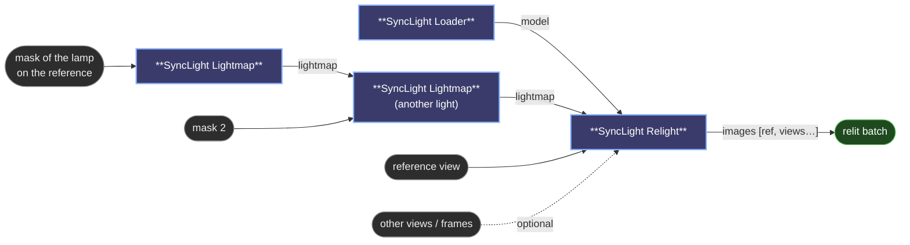

# 😺NKD SyncLight

Change the light in **one** photo and get every other view of the scene relit to
match. Built on [SyncLight](https://github.com/CVC-Color/synclight) (Serrano-Lozano
et al., NeurIPS 2026): a multi-view diffusion model that needs no camera poses and,
trained on pairs, works with any number of views. Video frames work as views too.

## Nodes

- **SyncLight Loader**: `weights` is the Hugging Face repo (`davidserra9/synclight`,
  downloaded once) or any folder in `models/synclight` with the `.yaml` and
  `.safetensors`. `precision` is bfloat16 (as released) or float32. The SDXL VAE is
  fetched from `stabilityai/stable-diffusion-xl-base-1.0` the first time.
- **SyncLight Lightmap**: `mask` marks the **light source** in the reference view (the
  lamp, the window), not the area it illuminates. `action` turns it on/set or off;
  `intensity` and `color` (hex) are the target. Plug its output into another
  Lightmap node's `previous` to edit several lights.
- **SyncLight Relight**: `reference` + optional `views` (batch) + `lightmap`. Output is
  `[reference, views…]`, relit, at the reference's size. `steps` 1 is the authors'
  recommendation. `offload` returns the model to the CPU afterwards.

## Notes

- The scene must be static and the views must show the lights being edited
  consistently. Images are resized internally to the closest training aspect
  bucket (e.g. 1024×1024, 1152×896, 1536×640) and back.
- All views go through the model together; memory grows with their number.
  For video, start with a few frames.
- Needs `diffusers`, `einops`, `pyyaml`, `huggingface_hub`, `pydantic` in ComfyUI's
  Python. Upstream pins `diffusers==0.32.2`; newer versions are untested here.
- Lightmap format, per the upstream README: `[activation, intensity, a, b]` with
  `intensity = (L + 1) / 2` and `a`, `b` the CIELAB colour divided by 128.
- Model code is vendored in `synclight_core/` (Apache-2.0, see its `NOTICE`).
  The dataset is CC BY 4.0.
